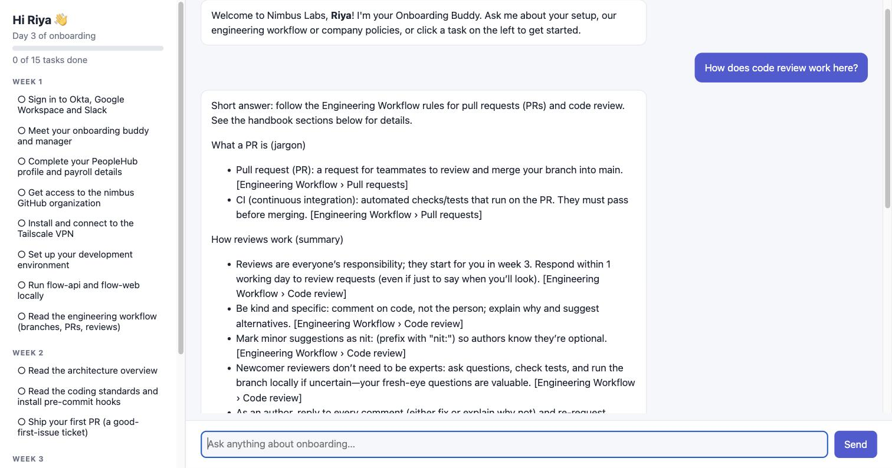
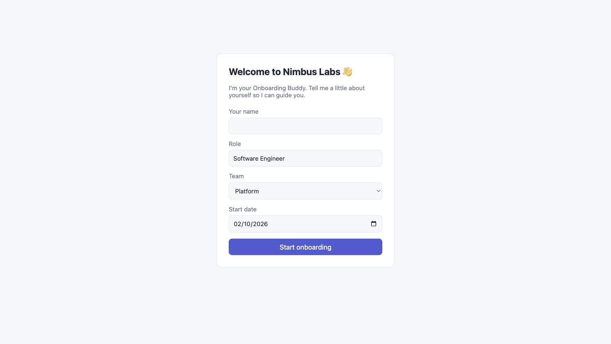
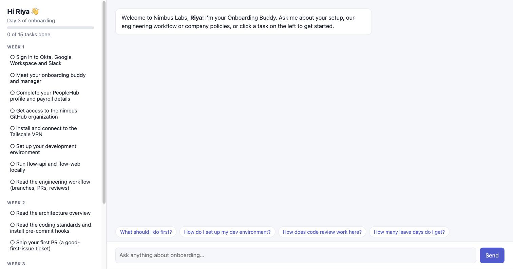
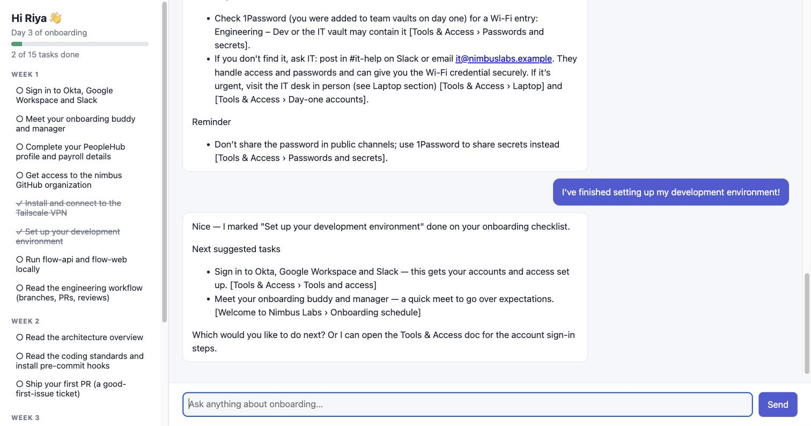
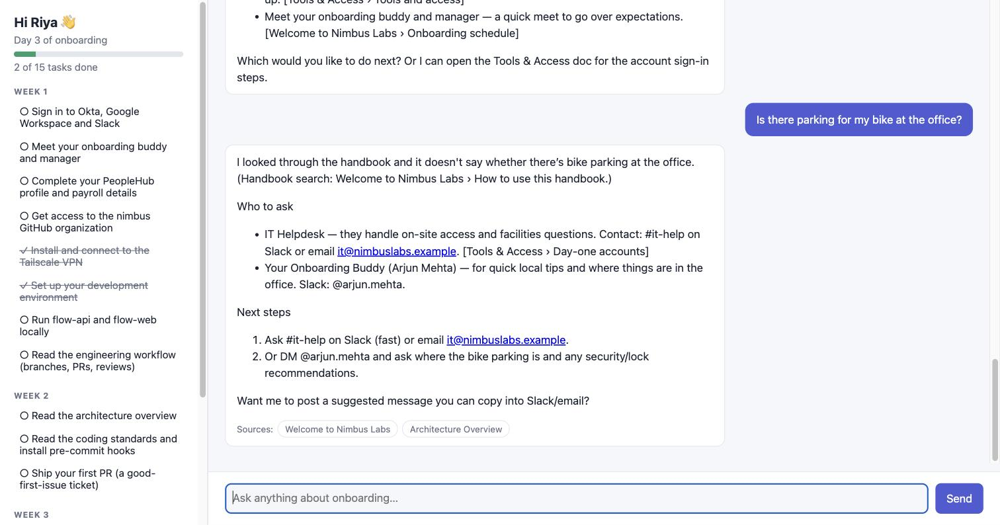
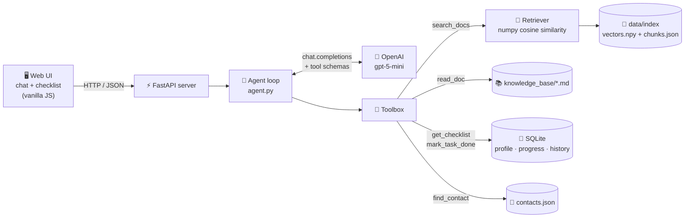
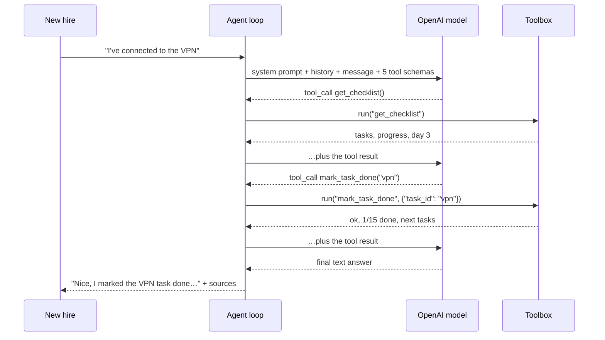

# 🧭 Onboarding Buddy

**An AI agent that guides a new software engineer through their first weeks at a company, using the company's own docs.**


-lightgrey)

Joining a company as a fresher is overwhelming: dozens of tools, unwritten rules, and a handbook nobody reads end to end. Onboarding Buddy is a chat assistant that:

- **answers questions from the handbook**, citing the exact section,
- **knows where you are** in onboarding ("Day 3"), with a week-by-week checklist,
- **ticks off tasks** when you say you've finished them,
- **admits when the docs don't cover something** and tells you who to ask.

The agent loop is **about 100 lines of plain Python with no agent framework**, so you can see exactly how tool calling works. It ships with a realistic sample handbook for a fictional company, *Nimbus Labs*, which you can swap for your own docs.



---

## Contents

- [Features](#features)
- [Screenshots](#screenshots)
- [Quick start](#quick-start)
- [Configuration](#configuration)
- [How it works](#how-it-works)
- [The sample handbook](#the-sample-handbook)
- [Use your own company docs](#use-your-own-company-docs)
- [Testing and evaluation](#testing-and-evaluation)
- [HTTP API](#http-api)
- [Project structure](#project-structure)
- [Design decisions](#design-decisions)
- [Troubleshooting](#troubleshooting)
- [Known limitations and roadmap](#known-limitations-and-roadmap)

---

## Features

| | |
|---|---|
| 📚 **Grounded answers** | Searches the handbook before answering company questions and cites sources as `[Doc › Section]`. Source chips under each answer show which docs were consulted. |
| ✅ **Onboarding checklist** | 15 tasks across 4 weeks. Say "I've connected to the VPN" and the agent marks the right task done; the sidebar updates live. |
| 📅 **Knows your timeline** | Uses your start date to compute your onboarding day ("Day 3", or "You start in 2 days") and suggests what to do next. |
| 🙋 **Knows who to ask** | If the docs don't cover a question, it says so plainly and points you to the right person or channel. |
| 🧑‍🎓 **Fresher-friendly** | Explains jargon ("PR", "CI", "release train") the first time it uses it. |
| 💾 **Remembers you** | Profile, progress and chat history persist in SQLite, so you can reload the page and pick up where you left off. |
| 🛡️ **Robust by design** | Bad tool calls go back to the model as errors, not crashes. There's a step limit on the loop, timeouts on API calls, and no half-saved chats on failure. |

## Screenshots

**1. First visit: tell the buddy who you are**



**2. Your checklist and chat: Day 3, with suggested questions**



**3. Answers grounded in the handbook, with citations**


**4. Say you finished something, and the checklist updates (2 of 15 done)**



**5. Not in the handbook? It says so and tells you who to ask**



---

## Quick start

**Prerequisites:** [uv](https://docs.astral.sh/uv/) (it installs Python 3.12+ for you) and an [OpenAI API key](https://platform.openai.com/api-keys).

```bash
git clone <this-repo> onboarding-agent && cd onboarding-agent

cp .env.example .env      # then paste your key: OPENAI_API_KEY=sk-...
uv sync                   # install dependencies into .venv

uv run ingest             # split the handbook into sections and embed them → data/index/
uv run serve              # → http://127.0.0.1:8000
```

Open http://127.0.0.1:8000, fill in your name, team and start date, and start asking questions. Good first questions:

- *What should I do first?*
- *How do I set up my dev environment?*
- *How does code review work here?*
- *I've connected to the VPN now.* (watch the checklist)
- *What's the office wifi password?* (not in the handbook, so watch it route you to IT)

> **Tip:** to start over as a brand-new hire, stop the server and delete `data/onboarding.db`.

## Configuration

All configuration lives in `.env` (copy it from `.env.example`):

| Variable | Default | What it does |
|---|---|---|
| `OPENAI_API_KEY` | (required) | Your OpenAI API key. |
| `OPENAI_MODEL` | `gpt-5-mini` | Chat model for the agent. It's cheap and reliable at multi-tool calling. Try `gpt-5-nano` to cut costs further. |
| `OPENAI_REASONING_EFFORT` | `low` | Sent as `reasoning_effort` to keep hidden reasoning tokens (and cost) down. **Leave empty** for models without reasoning support. |
| `OPENAI_EMBED_MODEL` | `text-embedding-3-small` | Embedding model for handbook search. Re-run `uv run ingest` if you change it. |
| `MAX_AGENT_STEPS` | `6` | Maximum rounds of tool use per message before the agent must answer. |
| `PORT` | `8000` | Port for `uv run serve`. |

**Cost:** a typical question makes 2–3 model calls, which is roughly half a US cent with `gpt-5-mini` (an estimate, not a measurement). Indexing the whole sample handbook costs a fraction of a cent. API calls time out after 60 seconds with one retry, so a stalled request becomes an error message instead of an endless spinner.

---

## How it works

### Architecture



### The agent loop

Every chat message runs through `Agent.chat` (`src/onboarding_agent/agent.py`):



1. **Build the conversation:** a system prompt (the rules, the new hire's profile, "today is day N", and the list of handbook docs), the last 20 chat messages, and the new message.
2. **Call the model** with the five tool definitions.
3. **If the model requests tools,** run each one, append the results as `tool` messages, and loop back to step 2.
4. **If the model answers with text,** that's the reply. The docs the tools touched become the source chips.
5. **Safety net:** after `MAX_AGENT_STEPS` rounds, one last call with `tool_choice="none"` forces a final answer.

### The tools

| Tool | When the agent uses it | Returns |
|---|---|---|
| `search_docs(query)` | Before answering any company-specific question | Top 4 handbook sections: doc id, title, section, text, similarity score |
| `read_doc(doc_id)` | When it needs a whole guide (e.g. step-by-step setup) | The full document. Only ids from the index are allowed, so `../.env` is rejected |
| `get_checklist()` | "What should I do next?" or to find a task id | Every task with its done status, progress counts, onboarding day, and the next 3 tasks |
| `mark_task_done(task_id)` | The user says they finished something | Confirmation plus updated progress |
| `find_contact(topic)` | The docs don't answer the question | The best-matching people or channels (or everyone, if nothing matches) |

If the model sends a bad tool call (unknown tool, invalid JSON, missing or extra arguments), the tool returns an `{"error": ...}` result to the model so it can correct itself. The request doesn't crash.

### Retrieval

`uv run ingest` turns the handbook into a searchable index:

1. **Chunk:** each Markdown file is split on its `##`/`###` headings. The `#` title becomes the doc title. Long sections are split on paragraph boundaries (about 1,500 characters max). `#` lines inside fenced code blocks (bash comments) are correctly treated as text, not headings.
2. **Embed:** each chunk is embedded as `"Doc Title › Section\n<text>"` with `text-embedding-3-small`.
3. **Save:** the vectors go to `data/index/vectors.npy` and the chunk metadata to `chunks.json`.

At query time, the question is embedded and compared against every chunk with cosine similarity (a single numpy dot product). For a handbook of this size (65 chunks), that's instant, and no vector database is needed.

### Guardrails in the system prompt

- Always search the docs before answering company questions, and cite every fact as `[Doc Title › Section]`.
- Never invent policies, URLs, commands, numbers or credentials.
- If the handbook doesn't answer the question, say so and call `find_contact`.
- Explain jargon briefly, because the user is likely a fresher.

---

## The sample handbook

`knowledge_base/` contains 10 handbook docs for the fictional company **Nimbus Labs**, which makes the workflow-automation SaaS *Nimbus Flow*:

| Doc | Covers |
|---|---|
| `00-welcome` | Company, values, teams (Platform / Growth / Integrations), who's who, your first day |
| `01-dev-environment-setup` | Homebrew, uv, Node, Docker, cloning repos, secrets, running `flow-api` and `flow-web`, troubleshooting |
| `02-engineering-workflow` | Trunk-based branching, Conventional Commits, PR rules, code review etiquette, CI/CD and the release train |
| `03-coding-standards` | ruff, mypy, pytest coverage, ESLint/Prettier, naming, pre-commit hooks, logging |
| `04-architecture-overview` | Services, AWS hosting, request flow, multi-tenancy, observability |
| `05-tools-and-access` | Okta, Slack, GitHub access, Tailscale VPN, 1Password, AWS access, laptop |
| `06-hr-policies` | Working hours, leave, payroll, probation, expenses, benefits, code of conduct |
| `07-first-90-days` | Week 1, days 1–30 / 31–60 / 61–90 expectations, rituals, how to ask for help |
| `08-glossary` | Company, engineering and process terms |
| `09-faq` | Short answers that point to the right doc |

Alongside them:
- `data/checklist.yaml` has the 15 onboarding tasks across weeks 1–4.
- `data/contacts.json` has 8 people and channels with the topics they help with.
- `evals/golden.yaml` has 14 test questions for retrieval.

All people and email addresses are fictional and use the reserved `nimbuslabs.example` domain.

## Use your own company docs

1. **Replace `knowledge_base/*.md`** with your docs. Give each file one `# Title` and `##` sections; every section becomes a searchable chunk. The file name (without `.md`) is the doc id.
2. **Edit `data/checklist.yaml`.** Each task needs an `id`, `week`, `title` and `doc_ref` (the doc id it relates to).
3. **Edit `data/contacts.json`.** Each entry needs a `name`, `role`, `channel` and a list of `topics`.
4. **Rename the company** in `src/onboarding_agent/prompts.py`, and update the team list in `web/index.html`.
5. **Re-index:** `uv run ingest`. Optionally update `evals/golden.yaml` and run `uv run eval` to check that search finds the right docs.
6. **Reset state:** delete `data/onboarding.db`.

---

## Testing and evaluation

```bash
uv run pytest     # 71 tests, fully offline
uv run eval       # retrieval quality against the real embedding API
```

**Unit tests (`tests/`)** never touch the network. `tests/fakes.py` provides:
- a deterministic bag-of-words `fake_embed`,
- a `FakeOpenAI` client that replays scripted responses (including tool calls and errors) and records every request.

The tests cover chunking edge cases, retrieval ranking, the SQLite store, every tool's happy path and failure modes, the agent loop (multi-tool turns, step limit, empty replies, API failures), the HTTP API, and consistency checks on the sample content.

**Retrieval eval (`uv run eval`)** asks each of the 14 questions in `evals/golden.yaml` and checks whether the expected doc appears in the top 4 search results. It exits non-zero below 80%. Current result:

```
Hit rate @4: 100% (14/14)
```

## HTTP API

| Method | Path | Body | Response |
|---|---|---|---|
| `GET` | `/api/employee` | none | `{"employee": {...} \| null}` |
| `POST` | `/api/employee` | `{name, role?, team, start_date}` | `{"employee": {...}}` (422 if invalid) |
| `GET` | `/api/checklist` | none | `{day, completed, total, tasks[], next_tasks[]}` |
| `GET` | `/api/history` | none | `{"messages": [{role, content}]}` |
| `POST` | `/api/chat` | `{message}` | `{reply, sources[]}`. Returns 409 with no profile, 422 for a blank message, 502 if OpenAI fails |
| `GET` | `/` | none | The web UI (static files from `web/`) |

Interactive docs are at http://127.0.0.1:8000/docs while the server runs.

## Project structure

```
onboarding-agent/
├── knowledge_base/            # sample handbook (10 Markdown docs)
├── data/
│   ├── checklist.yaml         # onboarding tasks
│   ├── contacts.json          # who to ask about what
│   ├── index/                 # generated by `uv run ingest` (gitignored)
│   └── onboarding.db          # generated SQLite state (gitignored)
├── evals/golden.yaml          # retrieval eval questions
├── src/onboarding_agent/
│   ├── config.py              # settings from .env, OpenAI client with timeouts
│   ├── embeddings.py          # OpenAI embeddings (batched) + normalization
│   ├── ingest.py              # markdown → chunks → embedding index   (uv run ingest)
│   ├── retriever.py           # cosine-similarity search over the index
│   ├── store.py               # SQLite: profile, progress, chat history
│   ├── tools.py               # tool JSON schemas + implementations
│   ├── prompts.py             # system prompt
│   ├── agent.py               # the tool-calling loop
│   ├── server.py              # FastAPI API + static UI                (uv run serve)
│   └── eval.py                # retrieval eval                         (uv run eval)
├── web/                       # index.html, app.js, styles.css (no build step)
├── tests/                     # pytest suite + network-free fakes
└── docs/
    ├── images/                # README screenshots
    └── superpowers/           # design spec and implementation plan
```

## Design decisions

- **No agent framework.** The goal is to *understand* agents. The loop (call model → run requested tools → feed results back → repeat) fits in about 100 readable lines. Frameworks like LangChain or the OpenAI Agents SDK earn their keep with multi-agent handoffs, tracing UIs and many integrations, none of which this project needs.
- **numpy instead of a vector database.** About 65 chunks fit in memory many times over. One matrix-vector product is the whole search engine, with nothing to install or run.
- **`gpt-5-mini` by default.** It's the cheapest model that reliably picks between five tools, matches task ids and stays within the docs. `gpt-5-nano` is a one-line change in `.env`.
- **Chat Completions with function calling.** It's the most widely documented tool-calling API, which makes the code easy to follow and port.
- **SQLite with a lock.** A single local user doesn't need a database server. One shared connection behind a `threading.Lock` is safe under FastAPI's thread pool.
- **Vanilla JS UI.** There's no build step. Markdown is rendered with `marked` and sanitized with `DOMPurify`, both loaded from a CDN pinned with Subresource Integrity hashes. If the CDN is unreachable, replies fall back to escaped plain text.

The full design spec and the task-by-task implementation plan are in [`docs/superpowers/`](docs/superpowers/).

## Troubleshooting

| Symptom | Fix |
|---|---|
| `OPENAI_API_KEY is not set` | Copy `.env.example` to `.env` and add your key. |
| Chat says *"OpenAI rejected the API key"* even though `.env` is correct | Your **shell exports an old `OPENAI_API_KEY`**, and environment variables take priority over `.env`. Remove the export from your shell profile, or run `env -u OPENAI_API_KEY uv run serve`. |
| `No search index … Run uv run ingest first` | Run `uv run ingest` (and re-run it whenever the docs change). |
| `Address already in use` | Another process is on port 8000. Stop it, or run `PORT=8001 uv run serve`. |
| The UI looks out of date after an update | Hard-reload the page (Cmd+Shift+R / Ctrl+Shift+R) to bypass the browser cache. |
| I want to start over as a new hire | Stop the server and delete `data/onboarding.db`. |

## Known limitations and roadmap

**Known limitations**
- When the agent suggests next tasks from the checklist, it sometimes cites a section heading that doesn't exist (e.g. "Tools & Access › Accounts"). The checklist gives it doc ids but not section names.
- Source chips list every doc the search touched, not only the ones cited in the answer, and they aren't restored after a page reload.
- It sometimes offers actions it can't perform (e.g. "I can post a message in #it-help").
- Single user, no login. It's built to run locally.

**Ideas for next steps**
- Pass real section names to the checklist tool and tighten the citation rules
- Stream responses token by token
- Multiple employees with login, and a manager view of onboarding progress
- A Slack bot front end
- Ingest PDFs and Confluence pages
- Rebuild the loop with the OpenAI Agents SDK and compare the two side by side
